# Waris — kalkulator waris Islam

Hitung pembagian waris menurut syariat Islam. Gratis, tanpa daftar, dalam bahasa Indonesia sehari-hari.
Live di **[waris.flavida.co](https://waris.flavida.co)**. Memakai Flavida Design System v4.1, tanpa maskot.

Aturan waris sudah baku: QS An-Nisa ayat 11, 12, dan 176, serta hadits sahih. Yang sulit adalah
hitungannya: pecahan, aturan penghalang (hijab), dan belasan kasus khusus. Situs ini menghitungnya untukmu.

---

## Tampilan

Semua gambar diambil dari aplikasi yang berjalan.

### Halaman utama

Demo berjalan sendiri di hero. Satu kasus dihitung dari awal sampai selesai.

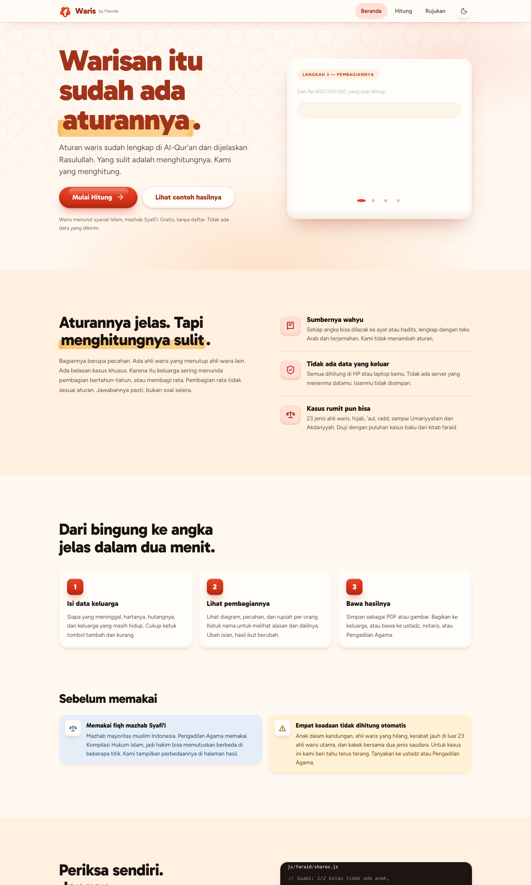

### Dua cara mengisi ahli waris

**Daftar.** Tombol +/−. Cepat, cocok untuk keluarga sederhana.

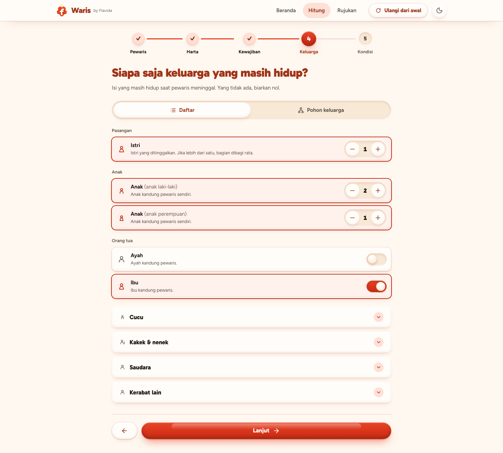

**Pohon keluarga.** Susun keluarga seperti aslinya. Cucu ditambah dari kartu anaknya. Keponakan dari
kartu saudaranya. Hubungan tidak perlu ditebak. Ini membedakan cucu lewat anak laki-laki (mewarisi)
dari cucu lewat anak perempuan (tidak mewarisi).

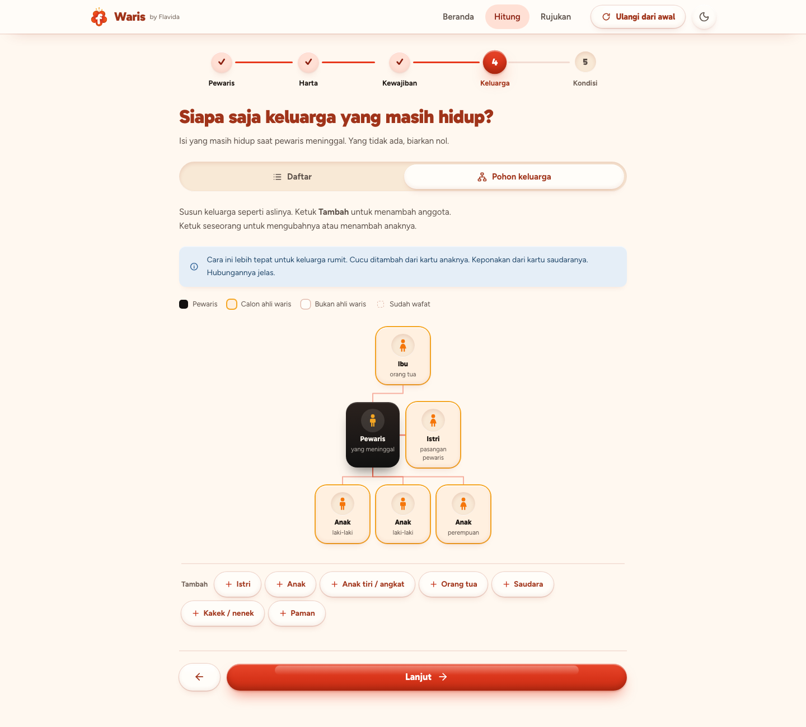

### Hasil

Urutannya: biaya jenazah, hutang, wasiat, lalu pembagian. Donut menunjukkan bagian tiap pihak dan rupiahnya.

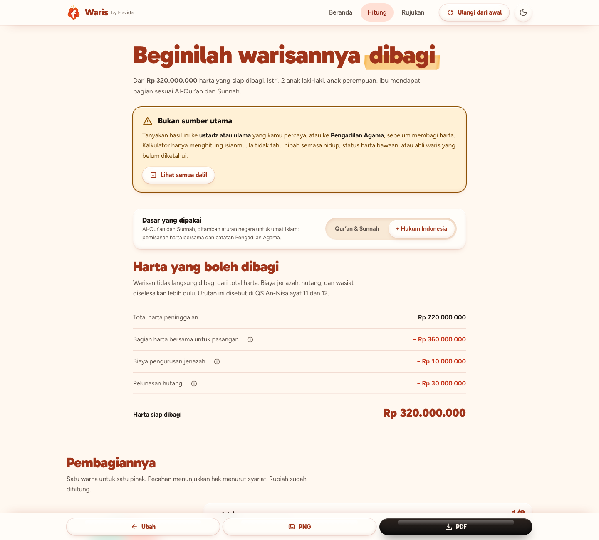

Pecahan dan rupiah tampil di pohon. Yang tidak dapat bagian tetap tampil, lengkap dengan alasannya.

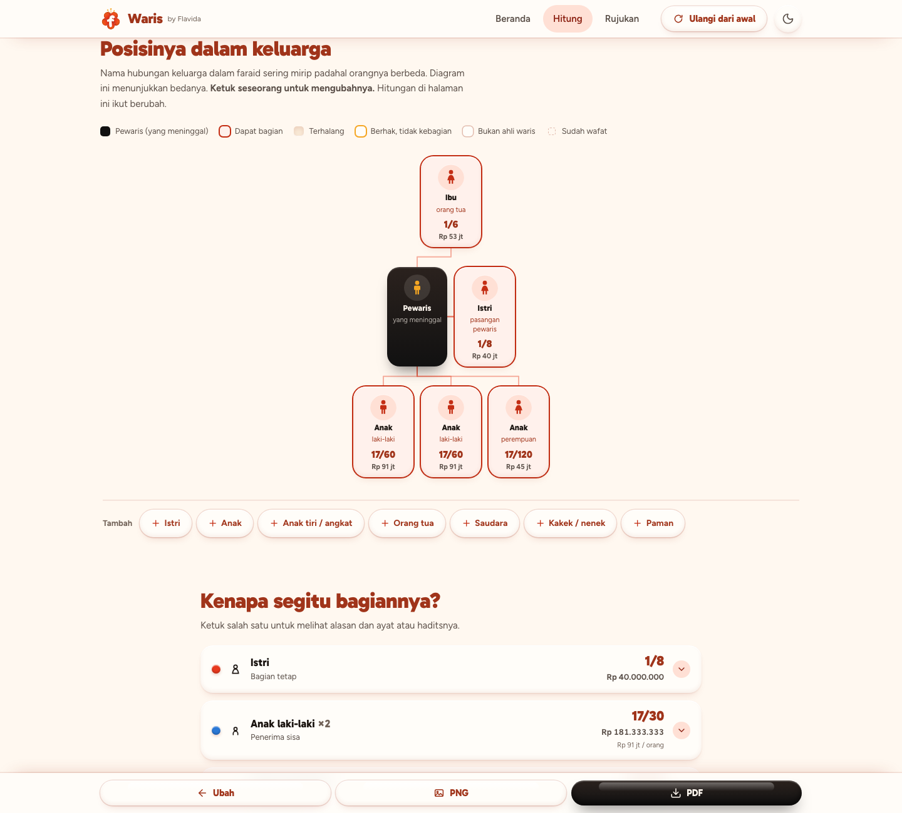

Ketuk seseorang untuk mengubahnya. Semua hitungan ikut berubah.

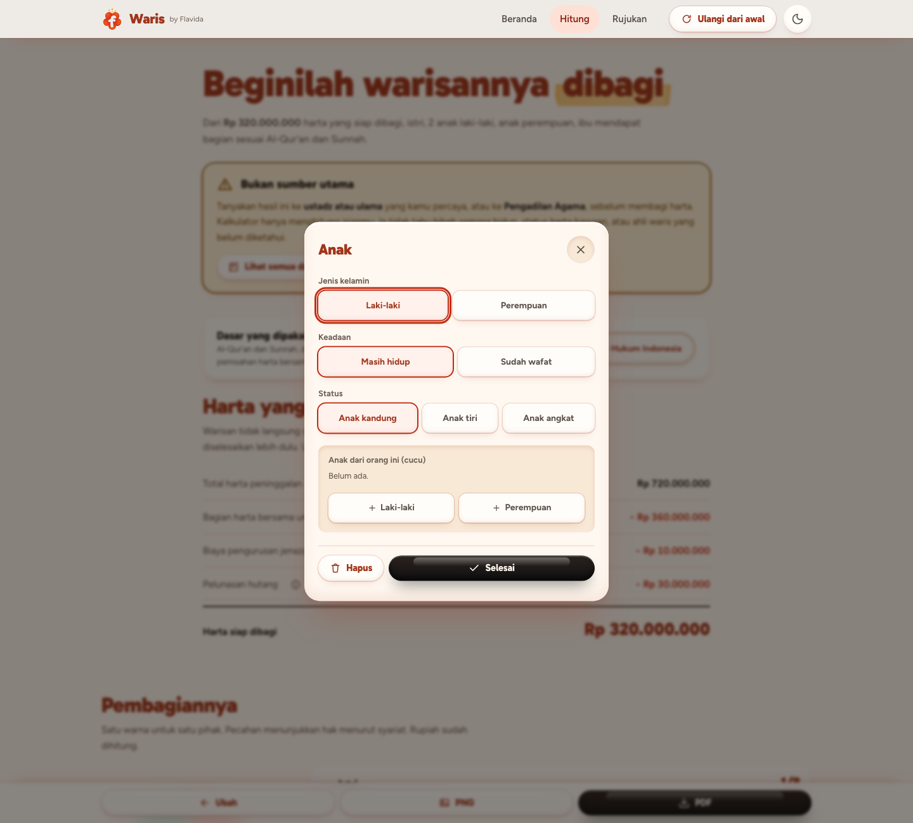

### Dalil tiap angka

Buka satu bagian untuk melihat alasan, teks Arab, terjemahan, derajat hadits, dan tautan sumber.

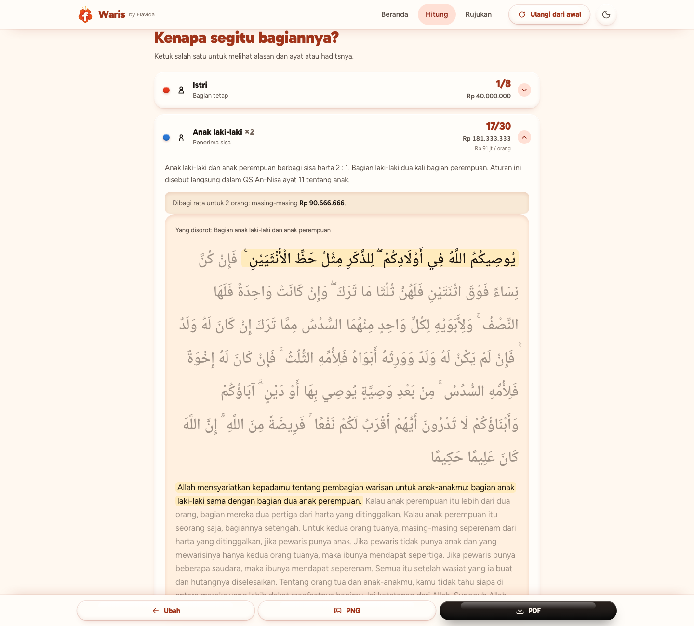

### Langkah selanjutnya

Checklist sesuai kondisi keluarga: dokumen, lembaga, dan mana yang wajib didahulukan.

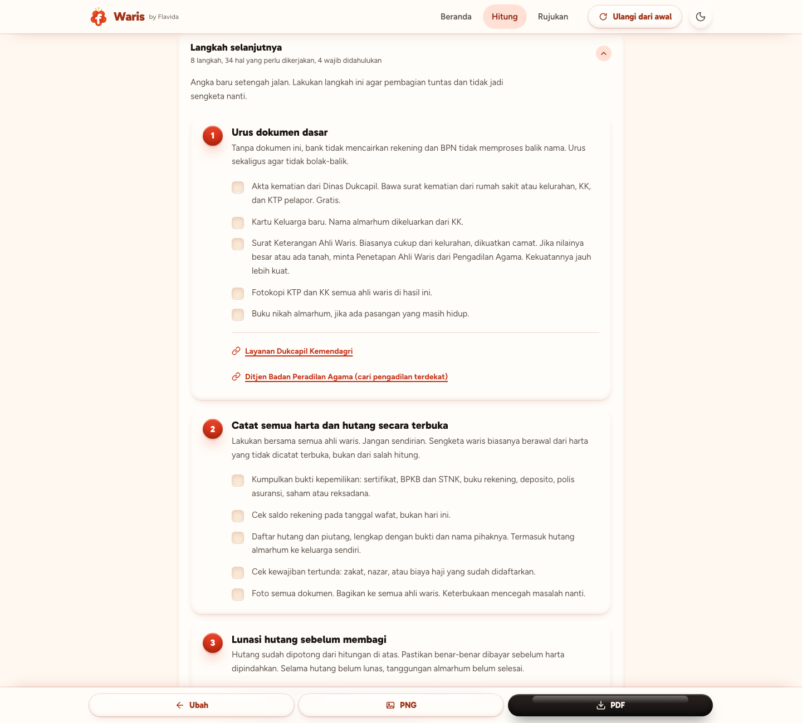

### Rujukan

Semua ayat dan hadits yang dipakai, dengan takhrij dan tautan ke hadits.id dan Qur'an digital.

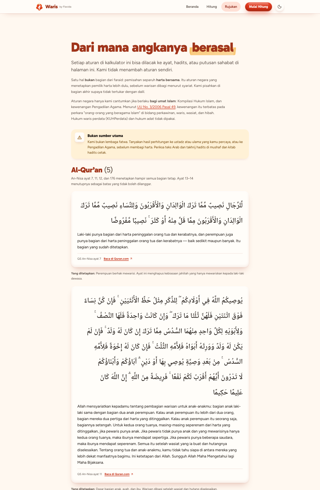

### Mobile

Mobile-first.

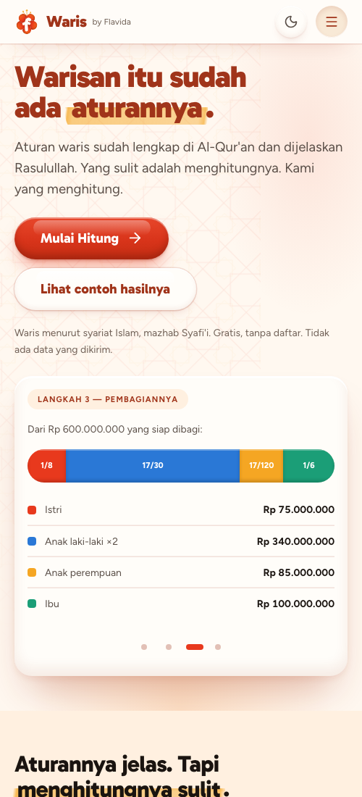

### Uji mesin faraid

`tests.html` menjalankan 97 kasus dengan jawaban baku dari kitab faraid. Jika satu saja merah, jangan percaya hasilnya.

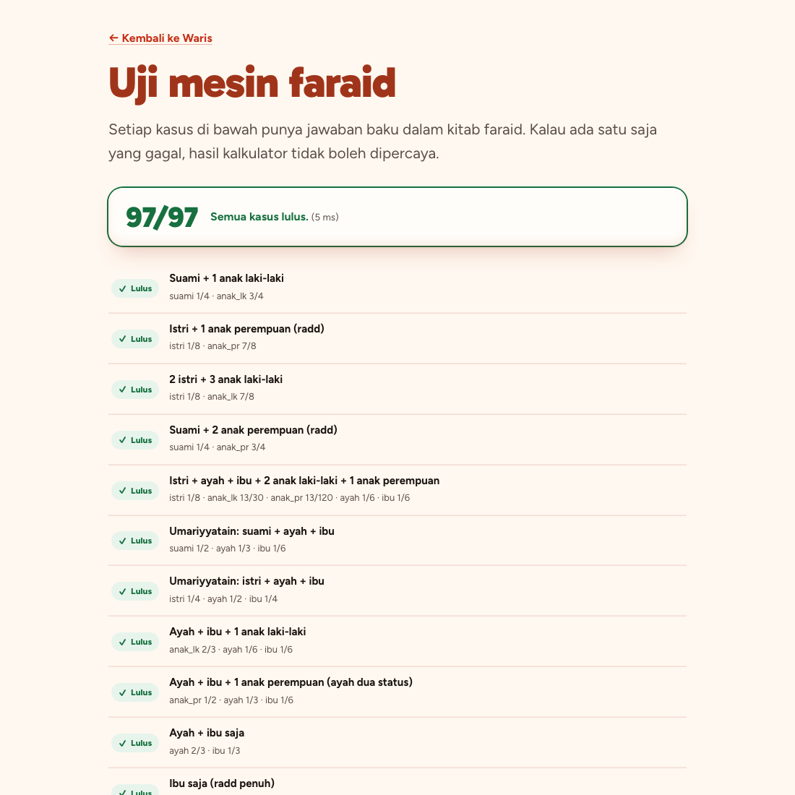

---

## Menjalankan

Tanpa build, tanpa dependency, tanpa npm.

```bash
python3 -m http.server 8123
```

Buka <http://localhost:8123>. Untuk produksi, unggah folder ini apa adanya ke hosting statis mana pun.

---

## Struktur

```
index.html              Halaman utama + demo
hitung.html             Wizard dan hasil (?contoh=1 memuat kasus contoh)
rujukan.html            Semua dalil
tests.html              Uji mesin faraid

colors_and_type.css     ┐ Kit Flavida Design System (salinan dari repo flavida-design-system).
flavida.css             │ Token, font self-hosted, komponen .fl-*.
flavida-extra.css       │ Jangan disunting di sini.
flavida-sections.css    ┘ Perbarui lewat tools/export-kit.sh.
fonts/                  Gabarito, Figtree, Noto Naskh Arabic (OFL)
assets/v4/              Bloom mark, ikon Lucide (+ lisensi)

css/
  waris.css             Yang tidak ada di design system: wizard, ledger, donut, pohon, lembar ubah
  print.css             Tata letak cetak / PDF

js/faraid/              Mesin perhitungan. Murni, tanpa DOM.
  fraction.js           Pecahan bilangan bulat
  heirs.js              23 ahli waris
  hijab.js              Aturan penghalang
  shares.js             Bagian tetap (ashabul furudh)
  ashabah.js            Pembagian sisa
  special.js            Umariyyatain, Akdariyyah, Musyarakah, kakek bersama saudara
  estate.js             Tirkah: harta bersama, biaya jenazah, hutang, wasiat
  solve.js              Orkestrator, 'aul, radd, rupiah

js/
  dalil.js              Data ayat dan hadits (statis)
  khi.js                Catatan Kompilasi Hukum Islam
  advice.js             Langkah selanjutnya
  keluarga.js           Model keluarga dan penurunan ahli waris
  ui-pohon.js           Diagram pohon
  ui-pohon-edit.js      Penyuntingan pohon
  ui-*.js               Tampilan lain
  nav-waris.js          Navbar: tombol utama hilang saat hero terlihat
  tema.js               Tombol terang/gelap
  export.js             PNG (canvas) dan PDF (dialog cetak)
  tests.js              97 kasus uji
```

---

## Model keluarga

`js/keluarga.js` menyimpan **struktur** keluarga, bukan angka. Cucu menempel pada anak tertentu.
Keponakan pada saudara tertentu. Sepupu pada paman tertentu. Daftar ahli waris diturunkan dari struktur itu.

Alasannya: seorang ibu wafat meninggalkan 3 anak perempuan yang sudah punya anak. Jika cucu diisi
di kolom "cucu", kalkulator mengira mereka cucu lewat anak laki-laki, lalu menyimpulkan ibu pernah
punya anak laki-laki. Hasilnya salah. Yang benar: cucu tidak berhak, saudara perempuan mendapat 1/12.

Dengan struktur, cucu lewat anak perempuan ditandai **bukan ahli waris**. Sama untuk anak angkat,
keponakan dari saudara perempuan, keponakan dari saudara seibu, dan sepupu perempuan.

### Anak kandung, tiri, angkat

Ketiganya berbeda. Akibat hukumnya di Indonesia juga berbeda.

| Status | Mewarisi? | Catatan |
|---|---|---|
| Anak kandung | Ya | Termasuk dari pernikahan sebelumnya. Nasab tidak terputus. |
| Anak tiri | Tidak | Mewarisi dari orang tua kandungnya. Wasiat wajibah KHI Pasal 209 **tidak** berlaku. Jalurnya hibah semasa hidup atau wasiat biasa maksimal 1/3. |
| Anak angkat | Tidak | Nasab tidak berpindah. KHI Pasal 209 memberi wasiat wajibah maksimal 1/3, lewat Pengadilan Agama. |

### Ayat tampil utuh

Satu ayat waris memuat beberapa ketetapan. QS An-Nisa 11 mengatur anak, ayah, dan ibu. QS An-Nisa 12
mengatur suami, istri, dan saudara seibu.

**Ayat tidak pernah dipenggal.** Seluruh ayat tampil sampai kalimat penutup. Ruas yang menetapkan
bagian orang yang sedang dibaca disorot. Sisanya dipudarkan.

Ayat disimpan sebagai deretan ruas di `js/dalil.js`. `arab` dan `terjemah` utuh diturunkan dari
gabungan ruas, jadi tidak mungkin ada dua versi teks. Ruas yang bukan ketetapan bagian memakai
`id: null`: tetap tampil, tidak pernah disorot. Satu kasus uji menjaga aturan ini.

| Ahli waris | Ayat | Ruas yang disorot |
|---|---|---|
| Istri, ada anak | An-Nisa 12 | "…jika kamu punya anak, mereka mendapat seperdelapan" |
| Istri, tanpa anak | An-Nisa 12 | "…seperempat jika kamu tidak punya anak" |
| Ibu, ada anak | An-Nisa 11 | "…masing-masing seperenam, jika pewaris punya anak" |
| Ibu, tanpa anak | An-Nisa 11 | "…maka ibunya mendapat sepertiga" |
| Ibu, ada 2 saudara | An-Nisa 11 | "…jika ia punya beberapa saudara, ibunya seperenam" |
| Anak lk + pr | An-Nisa 11 | "…bagian laki-laki sama dengan dua perempuan" |
| Saudara lk + pr | An-Nisa 176 | "…jika mereka saudara laki-laki dan perempuan…" |

Sebagian bagian punya **lebih dari satu sumber**. Ayat menetapkan besarnya, hadits menetapkan
mekanismenya. Contoh: anak yang mengambil sisa merujuk An-Nisa 11 (perbandingan 2 : 1) **dan**
HR Bukhari 6732 (siapa yang mengambil sisa).

Angka yang tidak ada di ayat mana pun dinyatakan sebagai qiyas. Contoh: 1/6 untuk saudara perempuan
seayah yang melengkapi 2/3, diqiyaskan pada putusan Ibnu Mas'ud tentang cucu perempuan (HR Bukhari 6736).

### Dua dasar hukum

Halaman hasil punya pilihan **"Qur'an & Sunnah"** atau **"+ Hukum Indonesia"**. Bawaannya syariat
murni. Mencentang harta bersama di langkah 3 menyalakan mode Indonesia, karena itu permintaan eksplisit.

| | Qur'an & Sunnah | + Hukum Indonesia |
|---|---|---|
| Pemisahan harta bersama | Tidak dipakai | Separuh dikeluarkan lebih dulu |
| Catatan Pengadilan Agama | Disembunyikan | Tampil, dengan tautan pasal |
| Checklist harta bersama | Disembunyikan | Tampil, dengan disclaimer dan sumber |
| Ekspor PNG dan PDF | Ikut pilihan | Ikut pilihan |

Angkanya benar-benar berubah. Pemakai bisa melihat persis apa yang ditambah aturan negara.

### Aturan negara: hanya untuk umat Islam

Rujukan utama tetap Al-Qur'an dan sunnah. Aturan negara dicantumkan hanya jika berlaku bagi umat
Islam, dengan tautan ke sumber:

| Rujukan | Dipakai untuk |
|---|---|
| [UU 1/1974 Pasal 35](https://pasal.id/peraturan/uu/uu-no-1-tahun-1974#pasal-35) | Harta bersama dan harta bawaan |
| [KHI Pasal 96, 185, 209](https://peraturan.bpk.go.id/Details/293351/inpres-no-1-tahun-1991) | Separuh harta bersama, ahli waris pengganti, wasiat wajibah |
| [UU 3/2006 Pasal 49](https://pasal.id/peraturan/uu/uu-no-3-tahun-2006#pasal-49) | Kewenangan Pengadilan Agama atas waris orang Islam |

Teks pasal diverifikasi lewat basis data peraturan resmi, bukan dari ingatan. KHI adalah lampiran
Inpres 1/1991 dan tidak terindeks per pasal. Kutipannya dicocokkan ke sumber Ditjen Badilag Mahkamah
Agung. **KUHPerdata dan hukum adat tidak dipakai.**

### Kerabat yang wafat lebih dulu

Ahli waris harus **masih hidup saat pewaris wafat**. Kerabat yang wafat lebih dulu tidak mewarisi.
Tapi ia tetap digambar, karena posisinya menentukan siapa naik menggantikannya di antrean ashabah.

| Yang wafat lebih dulu | Akibatnya |
|---|---|
| Pasangan | Bukan ahli waris. Anak dari pernikahan itu tetap mewarisi penuh. Tidak memakan jatah batas 4 istri. |
| Anak laki-laki | Bukan ahli waris. Anaknya (cucu lewat anak laki-laki) naik menggantikan. |
| Anak perempuan | Bukan ahli waris. Anaknya juga bukan: cucu lewat anak perempuan adalah dzawil arham. |
| Saudara laki-laki | Bukan ahli waris. Anak laki-lakinya masuk antrean ashabah sebagai keponakan. |
| Saudara perempuan | Bukan ahli waris. Anaknya juga bukan: keponakan hanya mewarisi lewat saudara laki-laki. |

Ini **bukan** ahli waris pengganti. Dalam fiqh, keponakan dan cucu masuk karena haknya sendiri sebagai
ashabah, dan bisa terhalang kerabat yang lebih dekat. Contoh: jika pewaris punya anak perempuan,
saudara perempuan kandung menjadi ashabah ma'al ghair dan **menghalangi** keponakan.

Ahli waris pengganti yang sebenarnya diatur KHI Pasal 185 dan hanya berlaku lewat Pengadilan Agama.
Perbedaannya tampil sebagai catatan, tidak diterapkan diam-diam.

Daftar (+/−) dan pohon menyunting model yang **sama**, jadi tidak mungkin bertentangan. Jika lewat
daftar kamu menambah cucu padahal belum ada anak laki-laki, kerabat penghubung dibuat otomatis dan
kamu diberi peringatan.

## Pohon keluarga

Pohon muncul di langkah 4 (alternatif daftar) dan di halaman hasil. **Keduanya bisa disunting.** Ubah
susunan, hitungan langsung menyesuaikan. Di lembar ubah, "Tambah anak" menambah cucu dari kartu anak
tertentu, dan keponakan dari kartu saudara tertentu.

Status simpul: pewaris · dapat bagian · terhalang · berhak tapi tidak kebagian ('aul) · bukan ahli
waris · sudah wafat · belum diisi.

Simpul disusun per generasi sebagai HTML biasa. Garis digambar ke `<svg>` di belakangnya, dari posisi
asli elemen setelah browser menata. Dua hal untuk diingat:

- **Jangan ubah ukuran simpul lewat CSS cetak.** Garis dihitung dari posisi di layar. Untuk cetak,
  seluruh pohon diperkecil dengan `transform: scale()` (lihat `siapkanCetak`).
- **Urutan simpul dalam satu baris menentukan garis menyilang.** Urutan keponakan harus mengikuti
  urutan saudara di atasnya.

Kerabat yang wafat digambar samar hanya jika menyambung seseorang ke pewaris (lihat `PENGHUBUNG`
di `ui-pohon.js`).

## Penamaan

Kartu isian memakai sebutan sehari-hari dulu, lalu istilah faraid dalam kurung: "Keponakan (keponakan
dari saudara kandung)". Mudah keliru: **anak dari saudara = keponakan**, **sepupu = anak dari paman**.
Keduanya ahli waris berbeda.

Mesin faraid tidak menyentuh DOM, jadi bisa diuji sendiri.

---

## Menguji

Buka <http://localhost:8123/tests.html>. Semua kasus harus hijau.

Dari terminal:

```bash
node -e "['faraid/fraction','faraid/heirs','faraid/hijab','faraid/shares','faraid/ashabah','faraid/special','faraid/estate','faraid/solve','keluarga','tests'].forEach(m=>require('./js/'+m+'.js'));const h=Tests.jalankan();const g=h.filter(x=>!x.lulus);g.forEach(x=>console.log('GAGAL',x.nama,x.pesan));console.log(h.length-g.length+'/'+h.length+' lulus')"
```

97 kasus. Isinya: tiap tingkat 'aul (6→7/8/9/10, 12→13/15/17, 24→27), radd dengan dan tanpa pasangan,
semua kasus khusus bernama, aturan hijab, hitungan tirkah, penurunan keluarga menjadi ahli waris
(termasuk yang gugur karena wafat lebih dulu dan keluarga sambung dengan anak tiri), dan pemeriksaan
bahwa dalil yang menempel pada satu bagian memang membahas ahli waris itu. Jawabannya dari kasus baku
kitab faraid.

---

## Dasar hukum

Hasil utama mengikuti **fiqh mazhab Syafi'i**, mazhab mayoritas muslim Indonesia. Jika susunan ahli
waris menyentuh titik di mana **Kompilasi Hukum Islam** (Inpres 1/1991) memutuskan berbeda, halaman
hasil menampilkan kotak catatan. Titik-titiknya: ahli waris pengganti (Pasal 185), wasiat wajibah
untuk anak angkat (Pasal 209), harta bersama (Pasal 96), dan radd kepada pasangan.

Untuk kasus yang ulamanya berbeda (Musyarakah, Akdariyyah, kakek bersama saudara), pendapat yang
dipakai disebut terang, bersama pendapat lainnya.

## Yang tidak dihitung

Sengaja tidak ditebak, karena butuh penilaian manusia. Situs akan memberi tahu dan mengarahkan ke
ustadz atau Pengadilan Agama:

- Anak dalam kandungan
- Ahli waris yang hilang (mafqud) dan khuntsa musykil
- Dzawil arham (kerabat di luar 23 ahli waris)
- Kakek bersama saudara kandung **dan** saudara seayah. Aturan mu'āddah belum diterapkan. Kasus ini
  ditandai perlu konsultasi.

## Privasi

**Nol permintaan jaringan** saat halaman dimuat. Font, ikon, dan skrip self-hosted. Tidak ada `fetch`,
`XMLHttpRequest`, atau cookie di seluruh kode. Isian tidak pernah disimpan. Semua dihitung di browser.
PNG digambar ke `<canvas>`. PDF lewat dialog cetak browser. Tanpa pustaka pihak ketiga, tanpa mengirim
apa pun ke luar.

Satu-satunya yang diingat: pilihan tema. Tombol terang/gelap di navbar menyimpan `light` atau `dark`
di `localStorage` (kunci `waris-tema`) agar terbawa antar halaman. Sebelum tombol ditekan, tampilan
mengikuti perangkat (`data-theme="auto"`). Saat cetak atau ekspor, tampilan selalu terang.

---

## Pemeriksaan dalil

**`js/dalil.js` perlu diperiksa satu kali oleh ustadz yang paham faraid**: teks Arab, terjemahan,
nomor hadits, dan derajatnya. Logika hitungan bisa dibuktikan dengan test. Keabsahan kutipan tidak
bisa. Ini menyangkut hukum agama.

Tiap kutipan sudah dicocokkan dengan [hadits.id](https://www.hadits.id) dan
[Quran.com](https://quran.com) (Agustus 2026). Tiap entri punya `tautan` ke sumbernya. Pencocokan
ini memastikan nomor dan teks benar. Ia bukan pengganti ahli, terutama untuk derajat hadits yang
antar ulama bisa berbeda.

Saat menambah dalil: **nomor hadits berbeda antar penerbit**. Selalu sertakan tautan, jangan cukup nomor.

---

## Berkontribusi

Ini menyangkut hukum agama dan harta keluarga. Kodenya dibuka agar siapa pun bisa memeriksa.

**Yang paling dibutuhkan:**

1. **Koreksi dalil**: nomor hadits, takhrij, terjemahan, atau kutipan yang keliru di `js/dalil.js`
   dan `rujukan.html`. Paling berharga, karena keabsahan kutipan tidak bisa diuji dengan test.
2. **Kasus uji baru** dari kitab faraid atau putusan Pengadilan Agama. Tambahkan ke `js/tests.js`
   beserta jawaban baku dan sumbernya.
3. **Laporan hitungan yang salah**, dengan susunan ahli waris lengkap agar bisa direproduksi.
4. **Aturan yang belum ditangani**, terutama mu'āddah. Saat ini hanya ditandai, belum dihitung.

Tidak perlu bisa ngoding. Tulis di *Issues* dengan bahasa biasa. Tidak punya GitHub juga boleh:

- **GitHub Issues**: <https://github.com/arnantoakbar/waris/issues>
- **Email**: <hello@flavida.co>
- **X**: [@FlavidaID](https://x.com/FlavidaID)

Sertakan rujukan pembanding jika ada (nomor hadits, nama kitab, atau tautan).

**Sebelum mengubah mesin faraid:** jalankan test dan pastikan semua lulus. Jika perilaku hitungan
berubah, tambahkan kasus uji yang membuktikannya.

**Versi aset:** rujukan css dan js memakai `?v=N`. Naikkan angkanya tiap merilis perubahan, agar
pengunjung lama tidak mendapat berkas basi dari cache.

---

## Desain

Mengikuti Flavida Design System v4.1:

- **Gaya clay.** Bentuk timbul memakai `--shadow-clay-*`. Bentuk cekung (isian, trek, kartu
  "terhalang") memakai `--shadow-inset`. Radius kartu 20px, isian 12px, tombol bulat penuh.
- **Tanpa maskot.** Ini situs keagamaan, jadi Flav tidak dipakai.
- **Tanpa kicker** di atas judul, tanpa teks gradien, tanpa emoji. Ikon dari sprite Lucide.
- **Kutipan** memakai `fl-cite` + `fl-arabic` (Noto Naskh Arabic), dengan lencana derajat hadits
  (`fl-grade`) berupa kata, bukan hanya warna.
- **Status tidak hanya warna.** Tiap status di pohon punya bentuk berbeda (timbul, cekung, garis
  putus, titik) *dan* kata ("terhalang", "bukan ahli waris").
- **Warna grafik** dari `--chart-1..8`. PNG ekspor memakai salinan heksanya, karena kanvas tidak
  mengerti `var()`, dan selalu terang.
- **Navbar, menu seluler, dan footer gelap** mengikuti situs Zakat. Navbar menempel di atas menu, dan tombol menu berubah jadi ✕ di tempat yang sama.
- **Tema gelap** ikut perangkat dan bisa diganti lewat tombol di navbar (`js/tema.js`). Komponen
  buatan sendiri hanya memakai token yang ikut berbalik.

Perbarui kit: jalankan `tools/export-kit.sh <folder-waris>` dari repo design system. Lalu hapus
berkas yang tidak dipakai (`themes/`, `flavida-app.css`, `js/flavida-ui.js`, `js/flavida-charts.js`,
logo selain bloom mark).

## Lisensi dan aset merek

Kit di root (`colors_and_type.css`, `flavida*.css`, `fonts/`, `assets/v4/`, `js/flavida.js`,
`js/motion.min.js`) berasal dari **Flavida Design System**. Bloom mark adalah aset merek **Flavida**.
Keduanya tidak untuk dipakai ulang di luar proyek ini. Font berlisensi OFL (`fonts/OFL-*.txt`), ikon
Lucide berlisensi ISC (`assets/v4/ICONS-LICENSE.txt`), Motion berlisensi MIT. Jika kamu memakai kode
kalkulatornya, ganti aset dan penamaannya.

Belum ada berkas LICENSE, jadi hak cipta sepenuhnya pada pemilik repositori. Jika ingin dibuka untuk
umum, tambahkan lisensi (misalnya MIT untuk kode, kecuali aset merek).

## Penafian

Ini alat bantu hitung, **bukan sumber utama**. Tanyakan hasilnya ke ustadz atau ulama, atau ke
Pengadilan Agama, sebelum membagi harta. Isi `js/dalil.js` dan `rujukan.html` perlu diperiksa ahli
faraid.
